# Datastore Management app { #datastore_management_app }

This page explains how to use the Datastore Management app to manage the global datastore and the user datastore. The app is intended for advanced-level DHIS2 users. For more information about the datastore, see [DHIS2 datastore](https://docs.dhis2.org/en/develop/using-the-api/dhis-core-version-master/data-store.html).

## Using the Datastore Management app

The Datastore Management app lets you manage the content of the web API global and user data stores. This helps when you manage apps and external scripts.

### 2.41.8 and earlier { #datastore_2_41_8_and_earlier }

-   In the Datastore Management app in 2.41.8 and earlier, namespaces and keys appear in a sidebar.
-   In the Datastore Management app in 2.41.8 and earlier, a **New** button adds a namespace.
-   In the Datastore Management app in 2.41.8 and earlier, the app manages the global datastore only.
-   In the Datastore Management app in 2.41.8 and earlier, there is no **UserDataStore** tab and no option to share a key.
-   In the Datastore Management app in 2.41.8 and earlier, namespace and key names cannot contain the character `#`.
-   The steps on this page apply to 2.41.9 and later.

## Choose a datastore

When the app opens, it loads all the namespaces in the global datastore. To choose the type of datastore, click the **DataStore** tab or the **UserDataStore** tab.

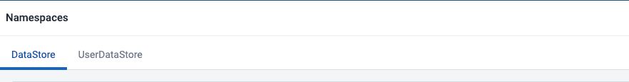

## Add a new namespace and key

In either datastore, click the **New namespace** button to add a new namespace.

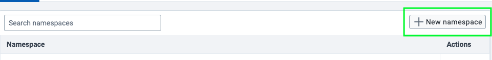{ width=75%}

The **Add New Namespace** modal opens. Enter a name in the **Namespace** field and a name in the **Key** field. Both fields are required. Click **Add**.

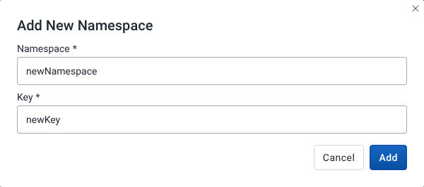

A name can have up to 255 characters. A name cannot contain any of these characters: `` (){},|\/^[]`;?:@=+$#% ``. The new key starts with the value `{}`.

Namespace and key names are case-sensitive. For example, the namespace `Capture` and the namespace `capture` are different namespaces.

## Search for a namespace

In the namespace list, enter text in the **Search namespaces** field. The list shows the namespaces whose names contain the text. The search ignores upper and lower case.

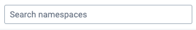

## Delete a namespace

In the namespace list, click **Delete** (trash icon) in the **Actions** column of the namespace.

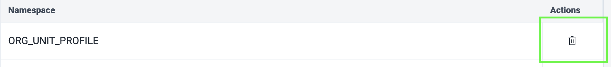{ width=75%}

The **Delete Namespace** modal opens. It states that deleting the namespace deletes all the keys in it. Click **Delete** to confirm.

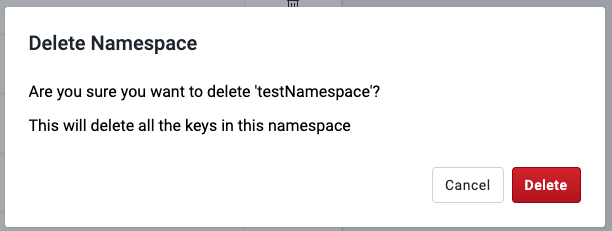

## View the keys in a namespace

Click a namespace. The app opens a page that shows all its keys.

### Add a new key

When you view the keys in a namespace, click the **New Key** button.

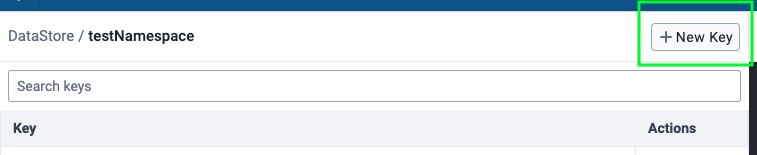{ width=60%}

The **Add New Key** modal opens. Enter a name in the **Key** field to add a key to the active namespace, and click **Add**. A new key starts with the value `{}`. The same limits on characters apply as for a namespace name.

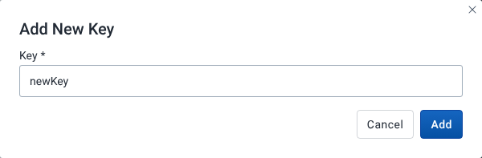{ width=60%}

### Search for a key

Enter text in the **Search keys** field. The list shows the keys whose names contain the text. The search ignores upper and lower case.

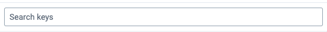

### Delete a key

Click **Delete** (trash icon) in the **Actions** column of the key.

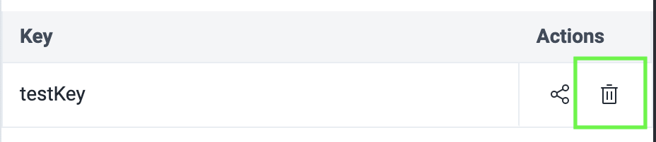{ width=50%}

The **Delete Key** modal opens. If the key is the last key in the namespace, the modal states that deleting it also deletes the namespace. Click **Delete** to confirm.

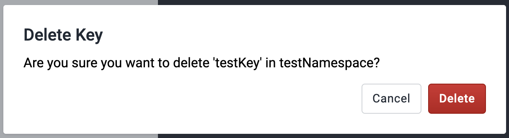{ width=60%}

### Share a key

This option is available only for keys in the global datastore, not the user datastore.

Click **Share** (share icon) in the **Actions** column of the key that you want to share.

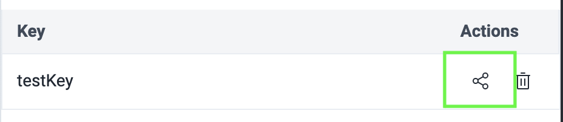{ width=50%}

The **Sharing and access** dialog opens. Use it to set access for different users and groups.

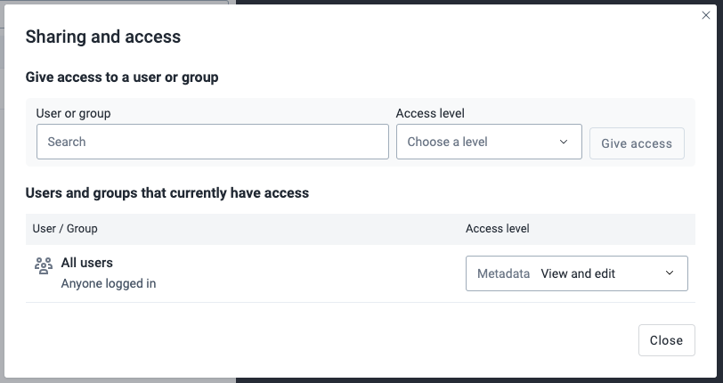{ width=60%}

### Edit a key

To edit the contents of a key, click the key. The app shows its value in the editor on the right. Edit the value in the editor.

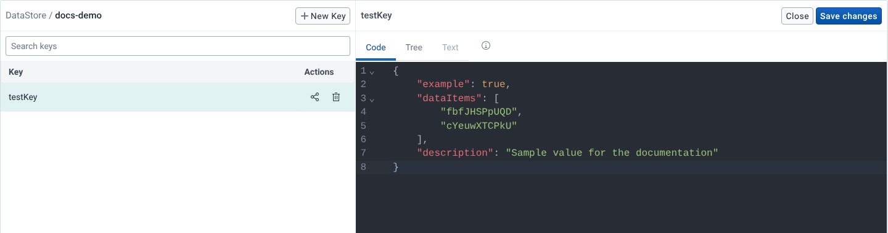{ width=90%}

-   To keep your edits, click **Save changes**.
-   To close the editor, click **Close**. If you have unsaved changes, the **Discard** modal asks you to confirm that you want to discard them. Click **Discard** to confirm.

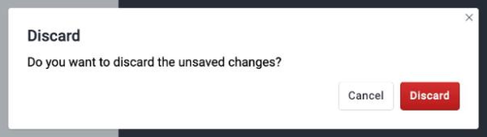{ width=60%}

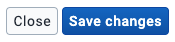

#### Editor tabs

The editor has three tabs. To see a short description of each tab, hover over the information icon next to the tabs.

-   **Code**: a free-form JSON editor.
-   **Tree**: expandable nodes of the JSON object. The tab is available only when the value is a JSON object or array.
-   **Text**: lets you add and edit data that is not JSON, for example JSONata or DataSonnet mapping expressions, and stores it as a string. The tab is available only when the value is a text string or an empty object.

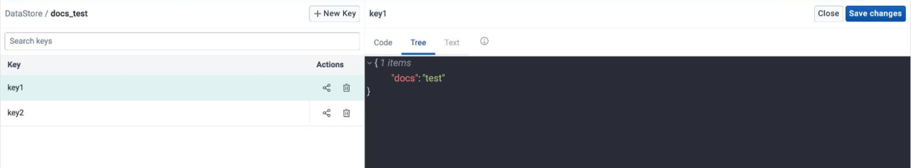

#### JSON editor

The **Code** tab validates your input and shows an error if the input is not valid JSON. For example:

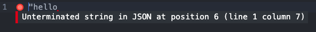

In the **Tree** tab, the message **Invalid JSON detected. Fix the value in the Code Editor** appears when the value is not valid JSON.

#### Before you save a value

The datastore stores the value that you enter as JSON. Keep these points in mind:

-   The datastore accepts script content, such as a `<script>` tag, and stores it unchanged. Check any value that you read from the datastore before you use it in another app or script.
-   The database rejects the control character `\u0000` and unpaired surrogate characters such as `\uD800`. If a value contains one of them, the save fails with a database error.
-   The datastore rejects values that are not valid JSON, for example a value with a comma after the last item.

#### Find and replace values

In the **Code** tab and the **Text** tab, open the search panel with a keyboard shortcut. The search panel helps you find and replace values in your data. On Windows, press `Ctrl + F`. On macOS, press `Cmd + F`.

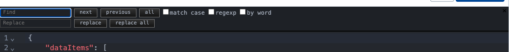{ width=90%}

### Back to the main page

Click the **DataStore** or **UserDataStore** link in the left panel header. This returns you to the main page, which lists all the namespaces in the selected datastore.

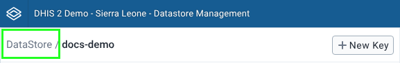

## Missing namespace errors in the browser console { #datastore_missing_namespace_errors }

Some apps read optional settings from the datastore. If the namespace or the key does not exist, the server returns a 404 error with the code E1005, for example `Namespace not found: 'capture'` or `Key 'ruleEngine' not found in namespace 'capture'`. Your browser console shows the error. In most cases the app works without the missing setting, and you can ignore the message.

In Capture app versions 105.0 to 105.2.1, a missing `capture` namespace stops the app from showing the enrollment and event forms. To work around this, click **New namespace**, enter `capture` in the **Namespace** field, enter any name in the **Key** field, and click **Add**. To fix the problem, update the Capture app to version 105.2.2 or later.

## 2.42.3 and earlier { #datastore_2_42_3_and_earlier }

-   In the Datastore Management app in 2.42.0 to 2.42.3, the editor shows only the JSON editor, with no **Code**, **Tree**, or **Text** tabs.
-   In the Datastore Management app in 2.42.0 to 2.42.3, the **Namespace** and **Key** fields in the **Add New Namespace** and **Add New Key** modals accept alphanumeric characters only.
